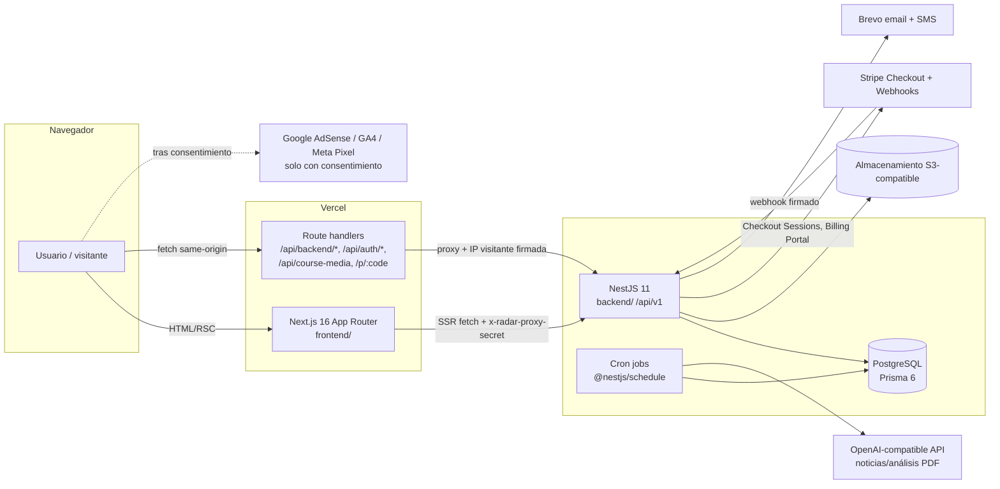

# Arquitectura

[← Índice](./README.md)

## Visión general

Radar VPO es un monorepo npm (`workspaces: backend, frontend`) con dos aplicaciones desplegadas por separado y una base de datos PostgreSQL.

| Capa | Tecnología | Ubicación | Despliegue |
|---|---|---|---|
| Frontend | Next.js 16.2 (App Router, React 19, Tailwind 4) | `frontend/` | Vercel (`frontend/vercel.json`, `vercel.json`) |
| Backend | NestJS 11, Passport JWT, class-validator, @nestjs/throttler, @nestjs/schedule | `backend/` | Railway (`backend/railway.json`, Nixpacks) |
| Datos | PostgreSQL + Prisma 6 (33 migraciones) | `backend/prisma/` | Railway Postgres |
| Ficheros | S3-compatible (`@aws-sdk/client-s3`) | `backend/src/storage/` | Proveedor configurado en `AWS_*`/`S3_*` |
| Pagos | Stripe Checkout (precios `price_data` calculados en servidor) | `backend/src/billing/` | Stripe |
| Mensajería | Brevo (email transaccional y SMS) | `backend/src/notifications/` | Brevo |
| CI | GitHub Actions (`ci.yml`: lint, unit, integración, build) | `.github/workflows/` | GitHub |

> Nota de Next.js: este proyecto usa Next 16 con cambios incompatibles respecto a versiones anteriores (ver `frontend/AGENTS.md`); `headers()`/`cookies()` son asíncronos y convierten la ruta en dinámica.

## Backend (`backend/src`)

| Módulo | Responsabilidad |
|---|---|
| `auth/` | Registro, login, refresh con rotación (hash SHA-256 + `jti`), verificación de email, recuperación de contraseña, cookies httpOnly |
| `users/` | Perfil (`/users/me`), preferencias, exportación de datos (RGPD art. 20), baja/anonimización (art. 17) |
| `billing/` | Checkout Stripe, webhook idempotente (`StripeProcessedEvent`), suscripción PRO y pack 3 meses, cancelaciones, reembolsos de cursos, consentimiento contractual |
| `courses/` | Catálogo, control de acceso (`evaluateAccess`), lecciones, progreso, guía PDF privada |
| `promotions/` | Promociones VPO (ventana limitada para visitantes), favoritos, enlaces cortos `/p/:code` |
| `alerts/` | Próximas promociones/alertas |
| `notifications/` | Plantillas, render con escape HTML, envío email/SMS Brevo, recordatorios PRO, historial de envíos (`DeliveryLog`) |
| `backoffice/` | API de administración (todas las rutas `JwtAuthGuard + RolesGuard + @Roles('admin')`) |
| `commerce/` | Ajustes de comercio, reglas promocionales, plantillas de mensajes |
| `jobs/` | Cron: scraping/comprobación de promociones, recordatorios, noticias diarias, retención de datos; bloqueo por `JobRun` |
| `news/`, `ai/` | Noticias con fuentes, portadas, proveedor IA |
| `storage/` | Subida validada (MIME + tamaño), claves no adivinables, URLs firmadas para privados |
| `common/` | Guards (JWT, roles, rate limit por IP real), filtros de error, nivel de acceso, utilidades |
| `metrics/`, `waitlist/`, `health/` | Visitas agregadas, lista de espera, `GET /healthz` |

### Controles transversales (`main.ts`, `app.module.ts`)

- `helmet()` (cabeceras de seguridad), `cookie-parser`, `trust proxy = 1`.
- CORS con lista blanca (`CORS_ORIGIN`, `FRONTEND_URL` y dominios canónicos). En producción el backend **no arranca** si faltan `CORS_ORIGIN`/`FRONTEND_URL`.
- **CSRF**: las peticiones no seguras (POST/PATCH/PUT/DELETE) que llevan cookies de sesión deben venir de un origen permitido (`Origin`, `Referer`, `x-client-origin` o `x-forwarded-host`). Verificado en modo producción: `PATCH /users/me` con `Origin: https://evil.test` → `403 Invalid request origin`; con el origen propio → pasa a autenticación.
- **Cache-Control** `private, no-store` en rutas de usuario y en **cualquier petición con credenciales**.
- `ValidationPipe` global con `whitelist` + `forbidNonWhitelisted` + `transform`.
- `AllExceptionsFilter`: en producción no devuelve mensajes internos; registra nombre/código/stack (sin mensaje en 5xx).
- **Rate limit**: `ClientIpThrottlerGuard` global (60/min por IP real; límites estrictos en auth/billing). Ver [operations.md#rate-limit](./operations.md#rate-limit).
- Swagger solo fuera de producción.

### Autenticación y autorización

- Access token JWT (7 días) y refresh token JWT (30 días) en cookies `httpOnly`, `secure` en producción. El frontend las re-emite como `SameSite=Lax` en su dominio.
- Cada petición autenticada comprueba en BD que la `Session` sigue activa y lee el **rol desde la BD** (un JWT antiguo no conserva privilegios revocados).
- Niveles de acceso (`common/access-tier.ts`, `courses.service.evaluateAccess`, `pro-access.service`):

| Nivel | Condición | Puede |
|---|---|---|
| Visitante | Sin sesión | Contenido público; primeras 10 promociones (sin paginar más allá); fichas con detalle bloqueado |
| Registrado sin verificar | Sesión, `emailVerifiedAt = null` | Igual que visitante. Puede comprar: la compra se registra pero **no se activa** |
| Registrado verificado | `emailVerifiedAt` | Listado completo, favoritos, cursos gratuitos/comprados |
| PRO | Verificado **y** (`plan = pro` o suscripción `active`/`trialing`) | Alertas SMS/email PRO, recordatorios, contenido PRO |

## Frontend (`frontend/src`)

- `app/`: 41 páginas y 20 route handlers ([endpoints.md](./reference/endpoints.md)).
- `app/api/backend/[...path]`: proxy genérico al backend (reenvía cookies, `x-client-origin`, IP del visitante firmada).
- `app/api/auth/*`: login/registro/refresh; fija cookies en el dominio del frontend.
- `lib/api.ts`: cliente usado en servidor (SSR, con `x-radar-proxy-secret`) y en navegador (`/api/backend`).
- `components/consent/`: banner y `ConsentedScripts` (AdSense, GA4, Meta Pixel solo tras consentimiento por categoría).
- CSP estricta por origen en `next.config.ts` (`frame-ancestors 'none'`, `object-src 'none'`, `upgrade-insecure-requests`); ver limitaciones en [security-audit.md](./security-audit.md).

## Modelo de datos

42 modelos y 28 enums. Diagramas por módulo en [reference/erd.md](./reference/erd.md) y diccionario completo en [reference/data-dictionary.md](./reference/data-dictionary.md).
