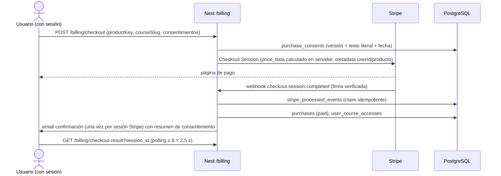
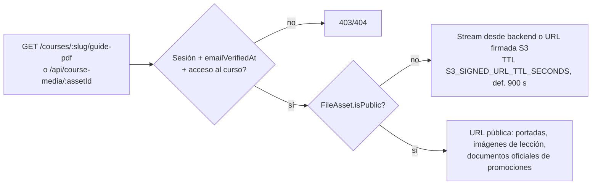
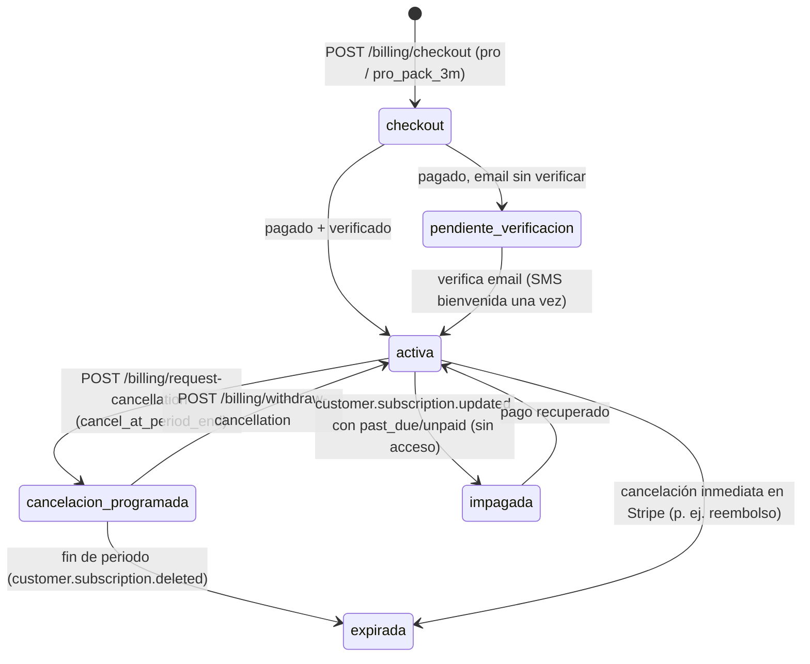
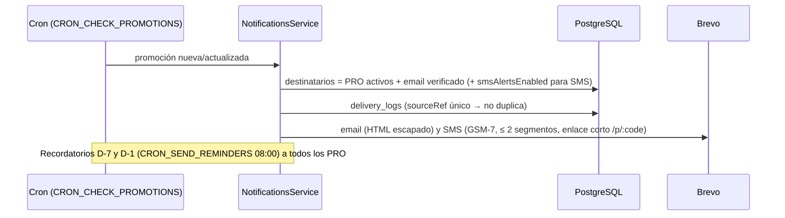
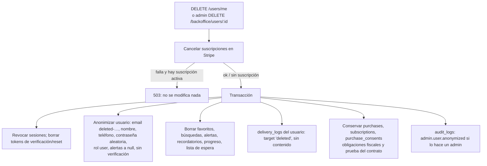

# Flujos principales

[← Índice](./README.md)

Cada flujo indica los endpoints implicados (ver [reference/endpoints.md](./reference/endpoints.md)) y las tablas que modifica (ver [reference/data-dictionary.md](./reference/data-dictionary.md)).

## 1. Registro y verificación de email

```mermaid
sequenceDiagram
  actor U as Usuario
  participant FE as Next (/api/auth/register)
  participant BE as Nest /auth
  participant DB as PostgreSQL
  participant BR as Brevo
  U->>FE: POST registro (email, nombre, teléfono, contraseña, consentimientos)
  FE->>BE: POST /auth/register (+ IP visitante firmada)
  BE->>DB: users (emailVerifiedAt = null), sessions, email_verification_tokens (hash, TTL 24 h)
  BE->>BR: email verificación (plantilla auth.verify_email, variables escapadas)
  BE-->>FE: tokens → cookies httpOnly
  U->>FE: abre enlace /verify-email?token=…
  FE->>BE: POST /auth/verify-email
  BE->>DB: users.emailVerifiedAt = now; invalida otros tokens
  BE->>BE: activatePaidAccessAfterVerification (compras/PRO ya pagados, SMS bienvenida una vez)
```

- Límites: registro 3/h por IP, verificación 10/min, reenvío 3/10 min y 60 s de espera entre reenvíos.
- Antes de verificar, el usuario puede corregir su email (`/auth/update-unverified-email`), no después.
- Contraseña: bcrypt (coste 10). Login con email inexistente ejecuta igualmente un `bcrypt.compare` (sin diferencia de tiempos).
- Recuperación: `/auth/forgot-password` (3/h, respuesta idéntica exista o no la cuenta, token 1 h, un envío cada 24 h por cuenta) → `/auth/reset-password` (revoca sesiones).

## 2. Sesión, refresh y cierre

- Access JWT 7 días, refresh JWT 30 días con `jti` único; en BD solo se guarda `SHA-256(refresh)` en `sessions.refresh_token_hash`.
- `/auth/refresh` rota el refresh: el anterior deja de ser válido (antes del fix, bcrypt truncaba a 72 bytes y todos los refresh del mismo usuario coincidían).
- Cada petición comprueba que la sesión no esté revocada ni expirada y lee el rol en BD.
- `/auth/logout` revoca la sesión.

## 3. Compra de curso / guía



- El precio nunca viene del cliente. Los códigos promocionales dependen de `allowPromotionCodes`.
- **Acceso efectivo** = compra pagada **y** `emailVerifiedAt` (`courses.service.evaluateAccess`). Sin verificar, la compra queda registrada y se activa al verificar.
- Idempotencia: `stripe_processed_events.id` = id del evento. Si un proceso muere a mitad, el claim `processing` caduca a los 10 min y Stripe puede reintentar.
- Desistimiento: el checkout recoge el consentimiento de suministro inmediato y la renuncia (TRLGDCU art. 103.m); `purchase_consents.first_content_opened_at` registra el inicio efectivo del suministro.

## 4. Acceso a la guía y ficheros



- La guía PDF y los documentos de lección se suben con `isPublic: false`; las claves S3 llevan 24 caracteres hexadecimales aleatorios.
- Las subidas validan MIME y tamaño (`MAX_FILE_SIZE_BYTES`, `COURSE_ASSET_MAX_SIZE_BYTES`, `PROMOTION_ASSET_MAX_SIZE_BYTES`) y solo las hace un administrador.

## 5. Suscripción PRO (mensual y pack 3 meses)



- Ambos productos son suscripciones de Stripe; el pack no se renueva si así se configuró (`cancel_at_period_end`).
- Los eventos `customer.subscription.*` se procesan **consultando el estado actual en Stripe** (evita aplicar eventos desordenados); si la suscripción ya no existe (404) se usa el snapshot del evento.
- Acceso PRO = verificado **y** (`users.plan = pro` o suscripción `active`/`trialing`). `past_due`, `canceled` y `expired` no dan acceso.
- **Reembolso PRO**: no se automatiza (un reembolso parcial de cortesía no debe cortar el acceso). Procedimiento: reembolsar en Stripe y, si procede retirar el acceso, cancelar la suscripción inmediatamente en Stripe → el webhook la marca expirada. Ver [operations.md](./operations.md#reembolsos-y-disputas).
- **Reembolso de curso**: `charge.refunded` total → `purchases.status = refunded` y se desactiva el acceso (salvo accesos concedidos a mano por un admin).

## 6. Notificaciones PRO (email + SMS)



- Los SMS no admiten botones: el enlace se acorta a `www.radarvpo.com/p/<code>`.
- El historial de envíos (`/admin/sms`) muestra asunto, contenido y motivo del envío.
- Son comunicaciones del servicio contratado (no publicidad); el usuario las gestiona desde Mi cuenta.

## 7. Cancelación de PRO

1. Usuario: `POST /billing/request-cancellation` → Stripe `cancel_at_period_end = true`, `users.pro_cancellation_requested_at`, email de confirmación.
2. Si no hay suscripción en Stripe (alta manual), queda como solicitud manual y se avisa a los administradores (`/admin` → cancelaciones → `processCancellationRequest`).
3. El usuario conserva el acceso hasta el fin del periodo pagado y puede retirar la solicitud.

## 8. Baja de cuenta (supresión)



- El administrador solo hace borrado físico si el usuario no tiene compras, suscripciones ni consentimientos; en otro caso se anonimiza (`mode: 'anonymized'`).
- Exportación de datos: `GET /users/me/export` (perfil, favoritos, compras, suscripciones, accesos, consentimientos).

## 9. Retención (opcional)

`purgeExpiredData` (cron `CRON_DATA_RETENTION`, def. 03:30) borra, **solo si `DATA_RETENTION_ENABLED=true`**: sesiones caducadas/revocadas > 30 días, tokens usados/caducados > 30 días, `delivery_logs` > 365 días, `delivery_failures` > 180, `job_runs` terminados > 90, eventos Stripe procesados > 180. Plazos en `backend/src/jobs/data-retention.ts`; deben coincidir con la política de privacidad antes de activarlo.
