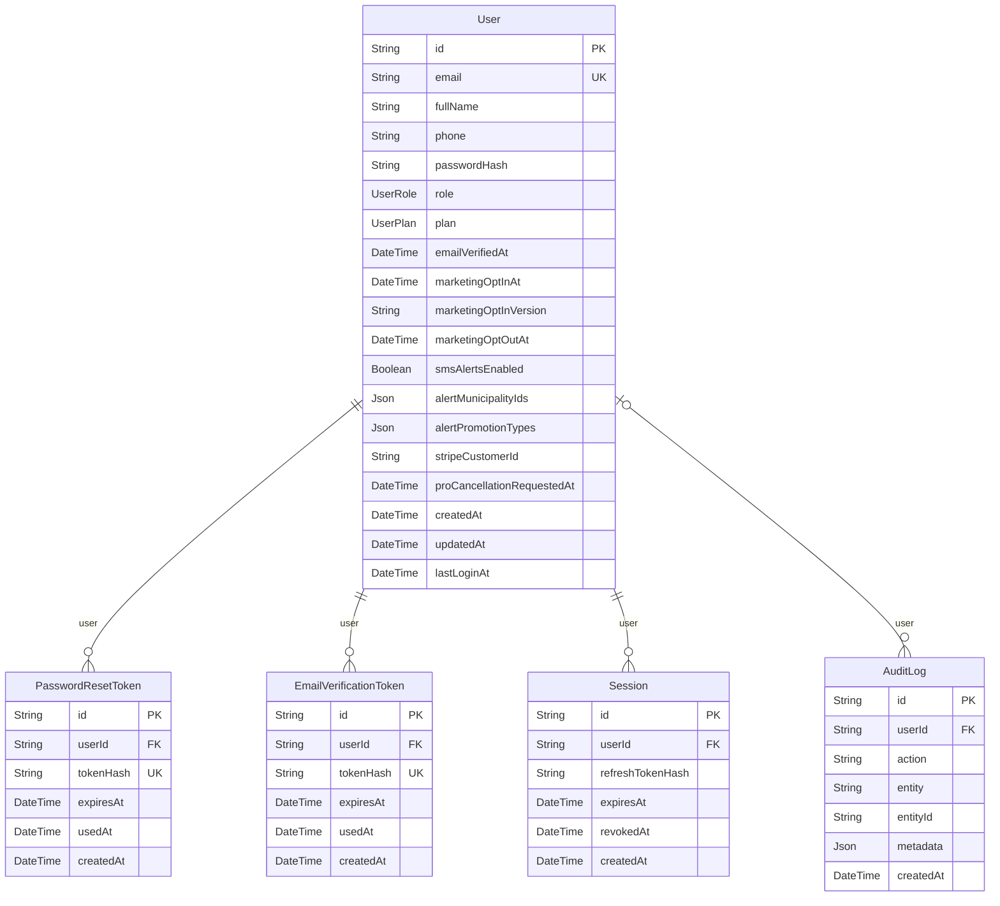
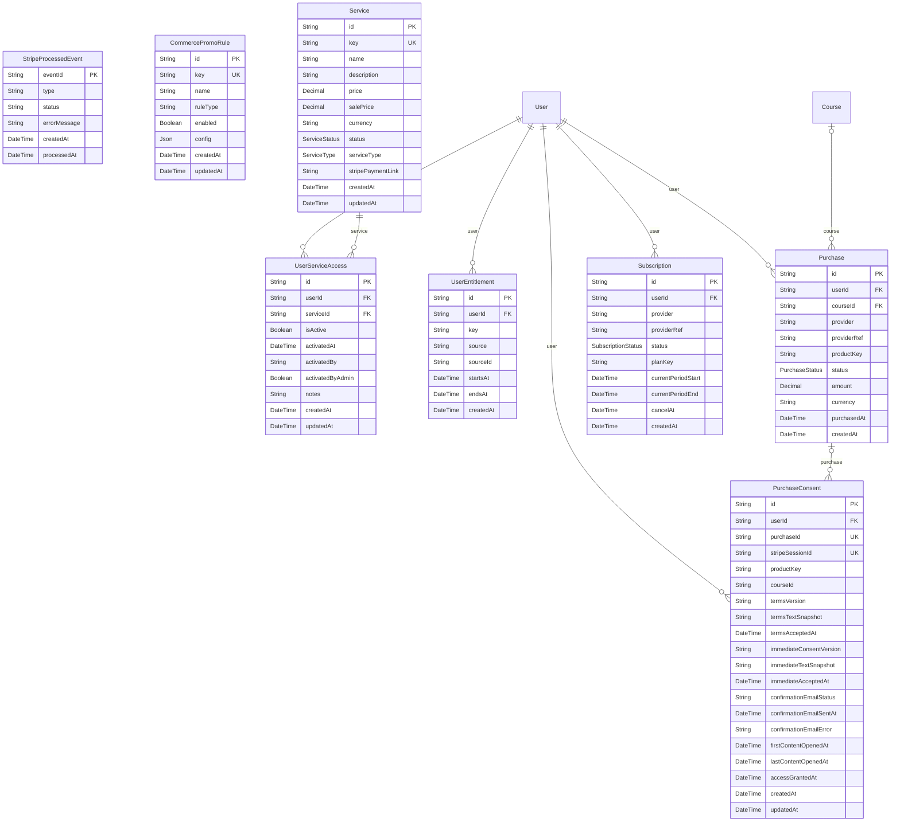
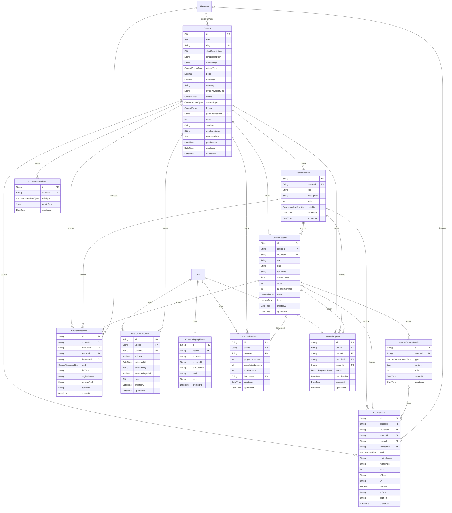
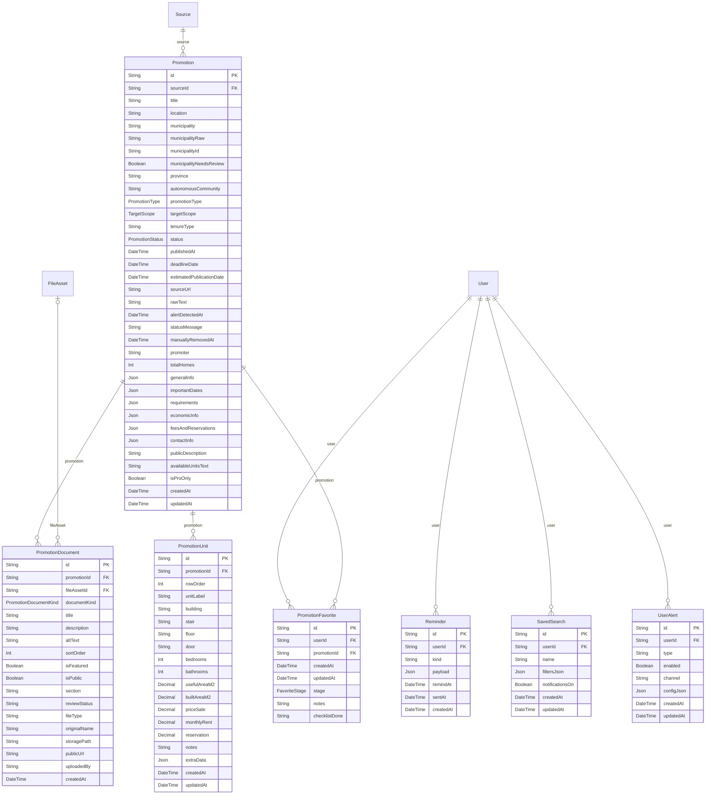
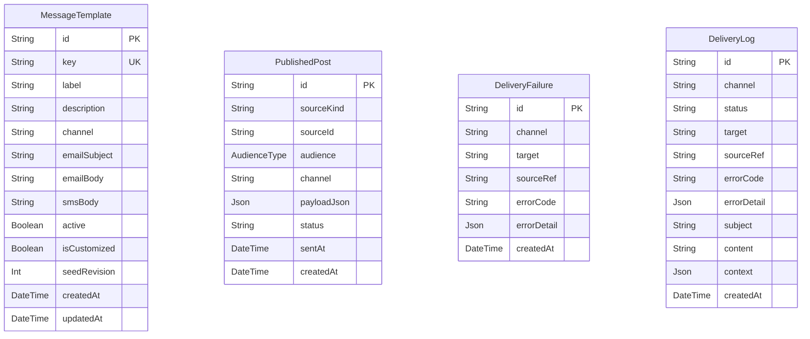
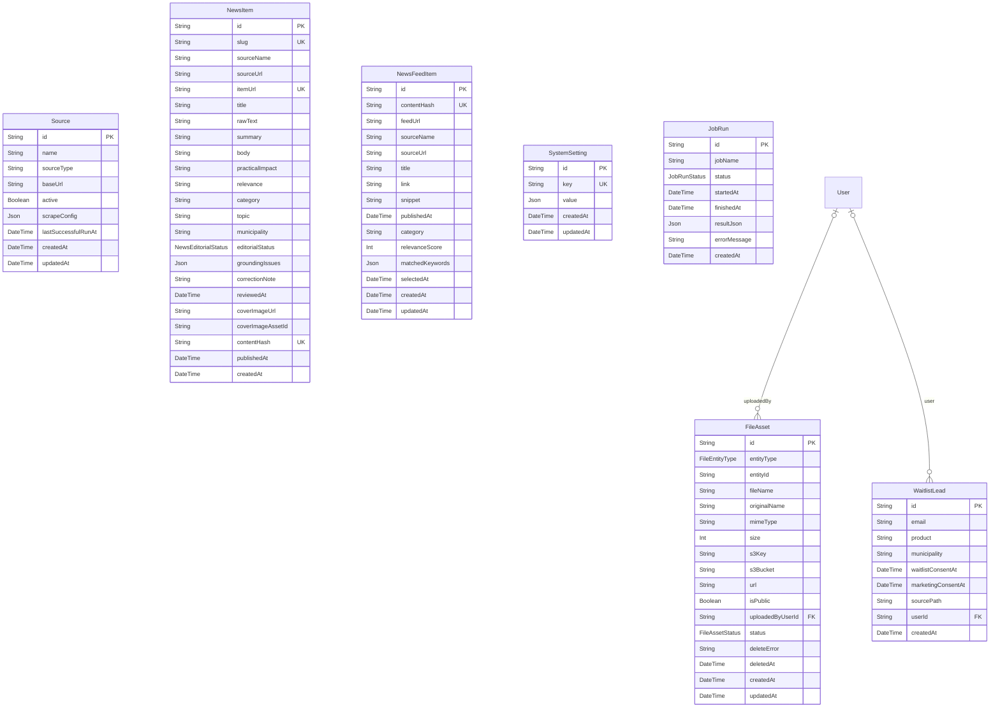

# Diagramas entidad-relación (Mermaid)

> Generado por `scripts/generate-reference-docs.mjs`. No editar a mano: ejecuta `npm run docs:reference`.

Un diagrama por módulo. Las relaciones con modelos de otros módulos se dibujan con la entidad externa sin atributos.

## Identidad y sesiones

## Comercio y pagos

## Cursos y guía

## Promociones y alertas

## Notificaciones

## Contenido, ficheros y operación

