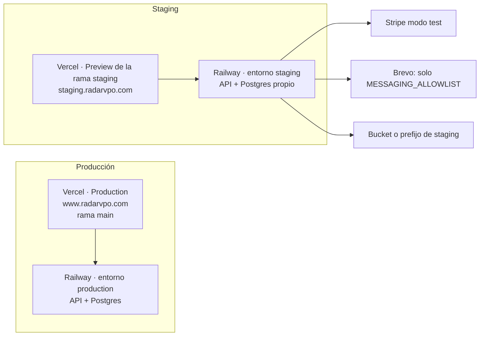

# Entorno de pruebas (staging)

[← Índice](./README.md)

Objetivo: una copia funcional de Radar VPO (web, API, base de datos, pagos, emails/SMS, cron) donde probar cambios **sin tocar producción**: otra base de datos, otro bucket, Stripe en modo test y envíos solo a destinatarios autorizados.



## ¿Hay que replicarlo todo?

| Pieza | ¿Duplicar? | Cómo |
|---|---|---|
| Backend (Railway) | Sí | **Environment** nuevo en el mismo proyecto Railway (no hace falta otro proyecto) |
| Base de datos | Sí, **siempre separada** | El environment de Railway crea su propio Postgres |
| Frontend (Vercel) | No hace falta otro proyecto | Mismo proyecto: rama `staging` con dominio propio y variables de *Preview* |
| Stripe | No otra cuenta | La misma cuenta en **modo test** (claves `sk_test_`, webhook de test) |
| Brevo | No otra cuenta | Misma cuenta; el backend de staging solo envía a `MESSAGING_ALLOWLIST` (los SMS de prueba consumen saldo real) |
| S3 | Sí: otro bucket (recomendado) | Así nunca se borran ni sobrescriben ficheros de producción |
| IA (OpenAI…) | Opcional | Misma clave con límite de gasto, o desactivar noticias (`NEWS_ENABLED=false`) |

## Protecciones incluidas en el código

Se activan con `APP_ENV` (backend) y `NEXT_PUBLIC_APP_ENV` (frontend) distintos de `production`. Sin esas variables todo se comporta como producción, así que **producción no cambia**.

| Protección | Dónde |
|---|---|
| Emails y SMS solo a `MESSAGING_ALLOWLIST` (emails, `@dominio` o teléfonos separados por comas). **La variable debe existir**: definida y vacía = no sale nada; sin definir no se filtra (y el backend lo avisa en el log al arrancar), para no bloquear nunca producción por un `APP_ENV` heredado. El resto queda en el historial como **"bloqueado (pruebas)"** | `backend/src/common/app-environment.ts`, `notifications.service.ts` (`postBrevo`) |
| El backend **no arranca** con una clave Stripe live (`sk_live_`/`rk_live_`) | `backend/src/config/env.validation.ts` |
| Enlaces de emails/SMS apuntan a la URL de staging, nunca a www.radarvpo.com | `backend/src/common/public-site-url.ts` |
| Meta Pixel, GA4 y AdSense sin IDs por defecto (no contamina conversiones ni audiencias reales) | `frontend/src/lib/marketing.ts`, `lib/ads.ts` |
| `noindex` (cabecera `X-Robots-Tag`, metadatos y `robots.txt` con `Disallow: /`) | `next.config.ts`, `app/layout.tsx`, `app/robots.ts` |
| Distintivo visible "Entorno de pruebas" en todas las páginas | `components/environment-badge.tsx` |

## Paso a paso

### 1. Rama

```bash
git checkout -b staging main && git push -u origin staging
```

Flujo: los cambios se fusionan en `staging`, se prueban, y después `staging` → `main` (producción).

### 2. Railway (backend + base de datos)

1. Proyecto → selector de entorno (arriba) → **New Environment** → *Duplicate* `production` con el nombre `staging`. Copia los servicios y sus variables; el Postgres del nuevo entorno está **vacío**.
2. En el servicio backend del entorno `staging` → Settings → Source: rama **`staging`**.
3. Settings → Networking → *Generate Domain* (p. ej. `radarvpo-api-staging.up.railway.app`).
4. Variables del backend en `staging`: ver la tabla de abajo. **Revisar una a una**: el duplicado trae los valores de producción.
5. Despliega. El arranque ejecuta `prisma migrate deploy`, que crea todas las tablas en el Postgres nuevo.
6. Crea un admin de pruebas: regístrate en la web de staging y, en la base de datos de staging, `UPDATE users SET role = 'admin' WHERE email = 'tu-email-de-pruebas';` (Railway → Postgres → Data/Query, **en el entorno staging**).

### 3. Vercel (frontend)

1. Project → Settings → Domains → añade `staging.radarvpo.com` (o usa la URL `*.vercel.app`) y asígnalo a la **Git branch `staging`**. En el DNS, el CNAME que indique Vercel.
2. Settings → Environment Variables: crea las variables de la tabla de abajo con entorno **Preview** y rama **`staging`** (*Select Custom Branch*), para no afectar a otras ramas ni a producción.
3. Redeploy de la rama `staging`.
4. Recomendado: Settings → Deployment Protection → mantener la protección de Vercel en Preview, para que solo tu equipo vea staging.

### 4. Stripe (modo test)

1. Dashboard en **modo test** → Developers → API keys → `sk_test_…` en `STRIPE_SECRET_KEY` de Railway staging.
2. Developers → Webhooks (modo test) → *Add endpoint*: `https://<api-staging>/api/v1/billing/webhook` con los eventos `checkout.session.completed`, `checkout.session.async_payment_succeeded`, `customer.subscription.created`, `customer.subscription.updated`, `customer.subscription.deleted`, `charge.refunded` → copia el `whsec_…` en `STRIPE_WEBHOOK_SECRET`.
3. Paga con las tarjetas de prueba de Stripe (`4242 4242 4242 4242`, cualquier fecha futura y CVC). Para probar renovaciones/cancelaciones: *Test clocks* de Stripe.

### 5. Datos de prueba

Empieza con la base vacía: el cron de promociones (`ENABLE_CRONS=true`) rellena promociones reales públicas. **No copies la base de datos de producción**: contiene datos personales (RGPD) y, aunque los envíos estén filtrados, no hay motivo para tenerlos en staging. Si alguna vez hiciera falta, solo con datos anonimizados y con autorización.

## Variables de entorno

### Backend (Railway, entorno `staging`)

| Variable | Valor en staging |
|---|---|
| `APP_ENV` | `staging` |
| `MESSAGING_ALLOWLIST` | **Obligatoria.** Tus emails/teléfonos de prueba, p. ej. `tu@gmail.com,@tu-dominio.es,+34600000000` |
| `NODE_ENV` | `production` (igual que prod: se prueba el mismo modo) |
| `DATABASE_URL` | La del Postgres del entorno staging (Railway la referencia sola: comprobar que **no** apunta al de producción) |
| `JWT_ACCESS_SECRET`, `JWT_REFRESH_SECRET` | **Nuevos** (`openssl rand -hex 32`); nunca los de producción |
| `BACKEND_PROXY_SECRET` | Nuevo, el mismo que en Vercel staging |
| `FRONTEND_URL`, `CORS_ORIGIN`, `PUBLIC_SITE_URL` | `https://staging.radarvpo.com` (o la URL vercel.app de la rama) |
| `COOKIE_DOMAIN` | Vacío |
| `STRIPE_SECRET_KEY`, `STRIPE_WEBHOOK_SECRET` | Modo test (paso 4) |
| `BREVO_API_KEY` | La misma u otra clave; `BREVO_PRO_ALERTS_ENABLED=true` si quieres probar avisos PRO (solo llegan a la allowlist) |
| `S3_BUCKET` (+ credenciales) | Bucket de staging |
| `ENABLE_CRONS` | `true` para probar todo; `false` si no quieres scraping/noticias |
| `NEWS_ENABLED` | `false` si no quieres gastar IA |
| `DATA_RETENTION_ENABLED` | `false` |
| `JOBS_ADMIN_TOKEN` | Nuevo o vacío |

### Frontend (Vercel, Preview → rama `staging`)

| Variable | Valor en staging |
|---|---|
| `NEXT_PUBLIC_APP_ENV` | `staging` |
| `API_URL`, `NEXT_PUBLIC_API_URL` | `https://<api-staging>/api/v1` |
| `NEXT_PUBLIC_SITE_URL` | `https://staging.radarvpo.com` |
| `BACKEND_PROXY_SECRET` | El mismo que en Railway staging |
| `NEXT_PUBLIC_META_PIXEL_ID`, `NEXT_PUBLIC_GA_MEASUREMENT_ID`, `NEXT_PUBLIC_GOOGLE_ADS_ID`, `NEXT_PUBLIC_ADSENSE_*` | **No definir** (o vacías) |
| `NEXT_PUBLIC_LEGAL_*` | Iguales que producción |

## Antes de nada: revisar producción

En Railway (entorno `production`), `APP_ENV` debe estar **vacía o con `production`**. Si tuviera otro valor (el `.env.example` antiguo traía `APP_ENV=local`), el backend se negaría a arrancar con la clave Stripe live; Railway mantendría la versión anterior, pero el despliegue fallaría. En Vercel, `NEXT_PUBLIC_APP_ENV` no debe existir en *Production* (o valer `production`).

## Comprobaciones tras montarlo

1. `https://<api-staging>/api/v1/healthz` → 200.
2. La web de staging muestra el distintivo amarillo "Entorno de pruebas" y `curl -I https://staging.radarvpo.com | grep -i x-robots-tag` devuelve `noindex`.
3. Registro con un email de la allowlist → llega la verificación y el enlace lleva a staging.
4. Registro con un email que no está en la lista → en `/admin/sms` aparece "bloqueado (pruebas)".
5. Compra con `4242…` → el webhook de test aparece en Stripe (modo test) con 200, y el acceso se activa.
6. En producción no aparece nada nuevo: ni usuarios, ni pagos en modo live, ni envíos.

Verificado localmente (backend con `APP_ENV=staging`, frontend con `NEXT_PUBLIC_APP_ENV=staging`): arranque rechazado con `sk_live_`; registro con email de la allowlist → intento de envío a Brevo; registro con otro email → `skipped / NON_PRODUCTION_RECIPIENT_BLOCKED` sin llamar a Brevo; `robots.txt` con `Disallow: /`, `X-Robots-Tag: noindex, nofollow`, meta `noindex` y distintivo visible.
